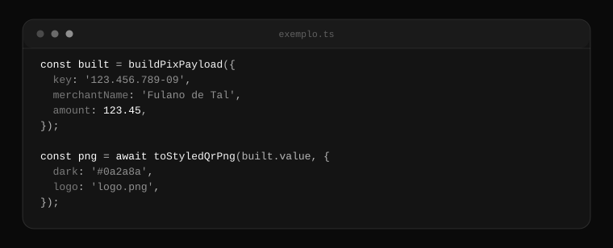
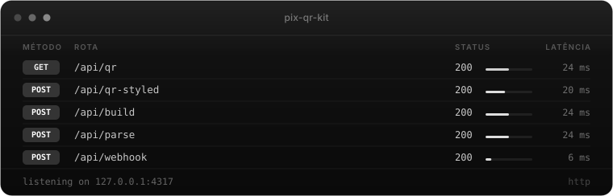
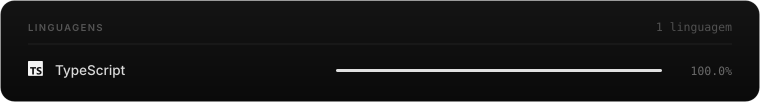

# @fraudar/pix-qr-kit

BR Code Pix (EMV), webhooks e conciliação em TypeScript. O `core` não tem dependências de runtime; o módulo `node` adiciona QR image, adapters de PSP e persistência.

<p align="center">
  
</p>

## Instalação

```bash
npm install @fraudar/pix-qr-kit
```

## Funcionalidades

### Core (`@fraudar/pix-qr-kit`)

| Função | O que faz |
| --- | --- |
| `buildPixPayload()` | chave/URL + valor + txid + nome/cidade → payload copia-e-cola com CRC correto |
| `parsePixPayload()` | payload → dados estruturados, validando CRC, GUI, moeda, país e campos obrigatórios |
| `crc16()` / `crc16Trace()` / `splitCrc()` | CRC-16/CCITT-FALSE (poly `0x1021`, init `0xFFFF`); `crc16Trace()` devolve o registro após cada byte para localizar divergências |
| `detectKey()` / `validateKey()` | detecta CPF, CNPJ (numérico e alfanumérico), e-mail, telefone, EVP e chave aleatória; valida dígitos verificadores com `strictKey` |
| `reconcile()` | compara cobranças esperadas com eventos recebidos e devolve `matched`, `orphans`, `duplicates`, `amountMismatch`, `missing` |

### Node (`@fraudar/pix-qr-kit/node`)

| Função | O que faz |
| --- | --- |
| `toQrPng()` / `toQrSvg()` / `writeQr()` | renderiza o payload como imagem |
| `toStyledQrPng()` | QR com módulos arredondados, finder patterns em gradiente e logo central (cor, tamanho e logo configuráveis); decodifica o resultado e só entrega se o payload voltar idêntico |
| `mercadopago()` / `asaas()` / `pagbank()` | adapters que verificam assinatura e normalizam eventos |
| `handleWebhookRequest()` | verifica → normaliza → resolve → deduplica → casa com a cobrança → persiste |
| `ChargeStore` / `InMemoryChargeStore` | contrato de persistência + implementação de referência |
| `parseCsv()` / `loadChargesCsv()` / `loadEventsNdjson()` / `reportToCsv()` | I/O para conciliação em arquivo |

## Exemplo: gerar e ler

```ts
import { buildPixPayload, parsePixPayload } from '@fraudar/pix-qr-kit';

const built = buildPixPayload({
  key: '123.456.789-09',
  merchantName: 'Fulano de Tal',
  merchantCity: 'Brasilia',
  amount: 123.45,
  txid: 'PEDIDO123',
  initiation: 'dynamic',
});
if (!built.ok) throw new Error(built.issues[0]?.message);
console.log(built.value);
// 0002010102122633...6304ABCD

const parsed = parsePixPayload(built.value);
// { mode: 'dynamic-key', key: { type: 'cpf', ... }, amountCents: 12345, txid: 'PEDIDO123', ... }
```

Pix dinâmico por URL usa `url` em vez de `key` e não aceita `amount` nem `txid` no payload — o app do banco faz o `GET`.

<p align="center">
  
</p>

### QR com cores e logo

```ts
import { toStyledQrPng } from '@fraudar/pix-qr-kit/node';

const png = await toStyledQrPng(built.value, {
  size: 640,
  dark: '#0a2a8a',
  light: '#ffffff',
  accent: '#1a6fbf',
  logo: './logo.png',   // caminho local, URL http(s) ou Buffer
  logoRatio: 0.14,
});
// png é um Buffer PNG. Por padrão o resultado é decodificado com jsQR e
// comparado ao payload; passe validate:false para desligar a conferência.
```

O logotipo usa correção de erro `H` e respiro branco; um logo ilegível é ignorado sem quebrar a leitura. Use `--styled` no CLI para o mesmo efeito.

## Exemplo: webhook

```ts
import { asaas, handleWebhookRequest, InMemoryChargeStore } from '@fraudar/pix-qr-kit/node';

const adapter = asaas({ webhookSecret: process.env.ASAAS_WEBHOOK_SECRET! });
const store = new InMemoryChargeStore().seed([
  { txid: 'PEDIDO1', amountCents: 12345 },
]);

export async function POST(req: Request) {
  const result = await handleWebhookRequest(
    {
      rawBody: await req.text(), // body cru: assinatura é calculada antes do JSON.parse
      headers: Object.fromEntries(req.headers),
    },
    { adapters: [adapter], store },
  );
  return Response.json(result, { status: result.status });
}
```

O `handleWebhookRequest()`:

1. escolhe o adapter cuja assinatura confere (comparação em tempo constante);
2. normaliza o payload para `PixEvent` (`payment.confirmed`, `payment.refunded`, `charge.expired`);
3. se o PSP só envia um `id` (Mercado Pago), chama `adapter.resolve()` com o `HttpClient` injetado;
4. grava o evento com chave única `(provider, externalId)` — redelivery vira `ignored` + finding `duplicate`;
5. casa o `txid` com a cobrança: confere valor, marca `confirmed` ou `divergent`, e registra `orphan` quando não há cobrança;
6. dispara `onEvent` opcional.

### Persistência real

Implemente `ChargeStore` no seu banco. O ponto não negociável é a unicidade:

```sql
CREATE TABLE pix_events (
  provider     text NOT NULL,
  external_id  text NOT NULL,
  payload      jsonb NOT NULL,
  received_at  timestamptz NOT NULL DEFAULT now(),
  PRIMARY KEY (provider, external_id)
);

CREATE TABLE pix_charges (
  txid         text PRIMARY KEY,
  amount_cents bigint NOT NULL,
  status       text NOT NULL DEFAULT 'pending',
  e2eid        text,
  paid_at      timestamptz
);

CREATE TABLE pix_findings (
  id           bigserial PRIMARY KEY,
  kind         text NOT NULL,
  key          text NOT NULL,
  txid         text,
  message      text NOT NULL,
  created_at   timestamptz NOT NULL DEFAULT now()
);
```

`recordEvent()` precisa ser atômica: `INSERT ... ON CONFLICT DO NOTHING` e `inserted = rowCount > 0`. Um `SELECT` seguido de `INSERT` deixa passar duas requisições concorrentes.

## Exemplo: conciliação

```ts
import { reconcile } from '@fraudar/pix-qr-kit';

const report = reconcile({
  charges: [{ txid: 'PEDIDO1', amountCents: 1000 }],
  events: [{ provider: 'asaas', externalId: 'evt_1', type: 'payment.confirmed', txid: 'PEDIDO1', amountCents: 1000 }],
  toleranceCents: 0,
});
// { totals: { charges: 1, events: 1, matched: 1, ... }, matched: [...], ... }
```

## CLI

<p align="center">
  
</p>

```bash
npm run pixqr -- build --key 123.456.789-09 --name "Fulano de Tal" \
  --city Brasilia --amount 123.45 --txid PEDIDO123
npm run pixqr -- parse "0002012633...6304ABCD"
npm run pixqr -- crc "0002012633...6304ABCD"
npm run pixqr -- crc "0002012633...6304ABCD" --explain   # registro do CRC byte a byte
npm run pixqr -- qr --payload "0002012633...6304ABCD" --out examples/pix.svg
npm run pixqr -- qr --payload "0002012633...6304ABCD" --styled --dark "#0a2a8a" \
  --accent "#1a6fbf" --logo logo.png --out examples/pix-styled.png

npm run pixqr -- webhook handle \
  --provider asaas --file examples/webhook-asaas.json \
  --secret demo-secret --charges examples/charges.csv

npm run pixqr -- reconcile \
  --charges examples/charges.csv --events examples/events.ndjson --format csv
```

Fixtures em `examples/` reproduzem os três cenários de divergência: pagamento com valor menor, `txid` desconhecido e cobrança sem evento.

## Servidor de demonstração

`node demo/server.mjs` sobe a API que alimenta a página do `demo/`. Ela usa o mesmo core da biblioteca e responde JSON.



| Método | Rota | O que faz |
|:--|:--|:--|
| `GET` | `/api/qr` | QR SVG do payload |
| `POST` | `/api/qr-styled` | QR estilizado em PNG |
| `POST` | `/api/build` | Monta o payload BR Code |
| `POST` | `/api/parse` | Lê e valida o payload |
| `POST` | `/api/webhook` | Verifica, casa e persiste |

## Notas de precisão

- Espaços dentro de nome/cidade são dados do payload; `parsePixPayload()` só remove `\r`/`\n` e faz `trim()` nas bordas.
- Comprimentos de campo contam caracteres ASCII. `normalizeAscii()` remove acentos antes de medir: `Brasília` → `Brasilia`.
- `txid` no dinâmico com chave é obrigatório pelo manual do Pix; no estático é opcional. O `***` dos exemplos é placeholder — use `--placeholder` no CLI se precisar reproduzir vetores oficiais.
- CNPJ alfanumérico (vigente desde julho de 2026) é detectado como `cnpj`: os 12 primeiros caracteres aceitam `0-9`/`A-Z`, cada letra vale `charCode - 48`, e os dois dígitos verificadores continuam numéricos. Confira [o FAQ da Receita Federal](https://www.gov.br/receitafederal/pt-br/centrais-de-conteudo/publicacoes/perguntas-e-respostas/cnpj/cnpj-alfanumerico.pdf).
- `parsePixPayload()` nunca lança: um TEMPLATE interno corrompido vira issue `malformed_tlv` com o caminho (`26`, `62`). A suíte muta cada caractere de um vetor áureo para garantir isso.
- Os mapeamentos de campos dos adapters seguem a documentação pública dos PSPs. Confirme no sandbox do seu PSP antes de produção; nomes de eventos mudam.

## Linguagens

O runtime inteiro é TypeScript; o `core` não carrega dependência externa nenhuma.



## Estrutura

```text
pix-qr-kit/
├── src/
│   ├── build.ts         buildPixPayload(), encodeTlv()
│   ├── parse.ts         parsePixPayload(), decodeTlv()
│   ├── crc.ts           crc16(), crc16Trace(), splitCrc()
│   ├── validate.ts      detectKey(), validateKey(), normalizeAscii()
│   ├── reconcile.ts     reconcile()
│   ├── types.ts
│   └── node/
│       ├── qr.ts        toQrPng(), toQrSvg(), writeQr()
│       ├── styled-qr.ts toStyledQrPng()
│       ├── adapters.ts  mercadopago(), asaas(), pagbank()
│       ├── handler.ts   handleWebhookRequest()
│       ├── store.ts     ChargeStore, InMemoryChargeStore
│       └── io.ts        parseCsv(), loadChargesCsv(), reportToCsv()
├── cli/pixqr.ts         build · parse · crc · qr · webhook · reconcile
├── demo/                servidor HTTP e página de teste
├── examples/            fixtures de webhook, cobranças e eventos
├── test/                vetores, mutação e conciliação
├── assets/              hero.svg · terminal.svg · example.svg · languages.svg · runtime.svg
└── package.json · tsconfig.json · README.md
```

## Desenvolvimento

```bash
npm install
npm test        # 27 testes
npm run build   # tsc -> dist/
npm run typecheck
```

MIT.
